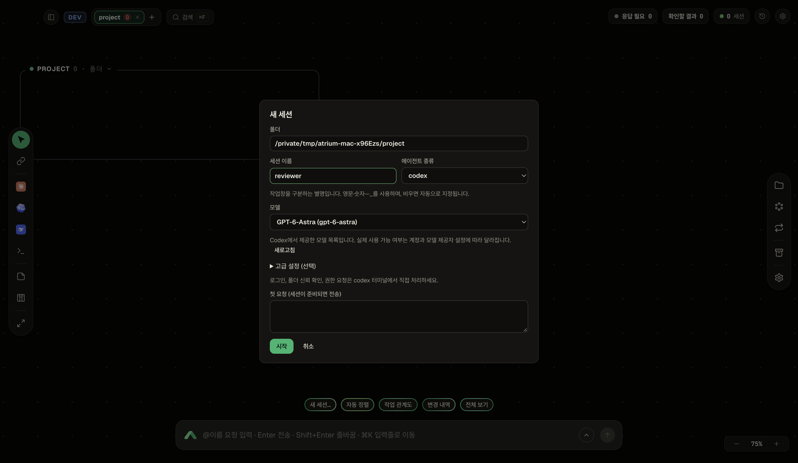

<p align="center">
  
</p>

<p align="center">
  <b>여러 AI 코딩 작업을 한 화면에서 관리하세요.</b><br>
  Claude Code, Codex, 터미널을 위한 macOS 작업 공간입니다.
</p>

<p align="center">
  <a href="README.md">English</a> · <b>한국어</b> · <a href="LICENSE">MIT</a>
</p>

Atrium은 여러 코딩 작업창을 넓은 작업 보드에 펼쳐 놓는 앱입니다. 어떤 AI가 작업 중인지, 어디에 응답해야 하는지 확인하고 각 세션에 요청을 보낼 수 있습니다. 실제 코딩은 연결된 Claude Code·Codex가 수행합니다.



*별도 테스트 프로젝트에서 촬영한 실제 화면입니다. 모델 목록은 설치된 Codex와 제공자 설정에 따라 달라집니다.*

## macOS에서 시작하기

**Node.js 24**, **Git**, 사용할 에이전트 CLI가 필요합니다. Claude Code나 Codex는 별도로 설치하고 로그인하세요. 일반 터미널만 사용할 때는 AI 계정이 필요하지 않습니다.

```sh
git clone https://github.com/Qualop/atrium-macos.git
cd atrium-macos/app
npm run setup:mac
npm run mac
```

`setup:mac`은 Apple Silicon 또는 Intel에 맞는 **herdr TUI 0.9.5**를 다운로드하고 SHA-256을 확인한 뒤, 앱과 백엔드의 npm 의존성을 설치합니다. herdr는 프로젝트의 `.tools/` 안에 저장하며 전역 설치나 셸 설정 변경은 하지 않습니다.

설치 후에는 `app/` 폴더에서 `npm run mac`으로 실행합니다. 다른 herdr 실행 파일을 쓰려면 `ATRIUM_HERDR`에 경로를 지정하세요. 현재 연동 버전은 **herdr 0.9.5 / 프로토콜 22**입니다.

## 첫 작업 시작하기

1. 왼쪽 위 **+**를 누르고 프로젝트 폴더를 선택합니다.
2. 아래의 **새 세션…**을 누르거나 왼쪽 에이전트 아이콘을 **Shift+클릭**합니다.
3. **세션 이름**에 `reviewer` 같은 별명을 입력합니다. 모델명이 아니라 작업창을 구분하는 이름입니다. 영문·숫자·`-`·`_`를 사용하며, 비우면 자동 지정됩니다.
4. **Codex**를 선택하고 **모델 드롭다운**에서 사용할 모델을 고릅니다. 새로고침, 기본 설정 사용, 모델 ID 직접 입력도 지원합니다. 실행 인자는 **고급 설정** 안에 있습니다.
5. 시작한 터미널에서 로그인, 폴더 신뢰 확인, 권한 요청에 직접 응답합니다.
6. 아래 입력창에서 세션 이름을 지정해 요청합니다.

   ```text
   @reviewer 이 프로젝트의 구조를 설명해줘. 파일은 수정하지 마.
   ```

모델 드롭다운은 설치된 Codex의 `model/list` 기능으로 목록만 조회하며 AI 작업을 시작하지 않습니다. 목록에 표시되더라도 실제 사용 권한은 계정과 제공자 설정에 따라 달라집니다. 선택한 모델은 추가 실행 인자의 모델 옵션보다 우선합니다.

`Enter`는 전송, `Shift+Enter`는 줄바꿈입니다. `⌘K`로 입력창에 이동하고 `⌘F`로 검색합니다. `@all`은 현재 프로젝트뿐 아니라 **보드 전체의 에이전트 세션**에 요청을 보냅니다. 일반 셸 명령은 해당 터미널에 직접 입력하세요.

앱이 영어로 열리면 **설정 → 언어 → 한국어**를 선택하세요.

## 주요 기능

| 기능 | 설명 |
|---|---|
| 무한 작업 보드 | 프로젝트와 세션을 원하는 위치에 배치합니다. 확대하면 실제 터미널, 축소하면 요약 카드로 표시합니다. |
| 에이전트 실행 | Claude Code, Codex, 일반 터미널을 실행합니다. DeepSeek은 별도로 구성한 opencodex 게이트웨이를 통해 Claude Code에서 사용합니다. |
| Codex 모델 자동 감지 | 모델 선택, 새로고침, 직접 입력을 지원합니다. 세션 이름과 모델을 별도 항목으로 표시합니다. |
| 응답 필요·확인할 결과 | 승인이나 답변이 필요한 작업과 아직 확인하지 않은 결과를 모아 보여줍니다. Claude Code는 더 자세한 상태·승인 기능을 제공합니다. |
| 창 그룹 | 여러 세션을 분할 배치하고 경계선을 움직여 크기를 조절합니다. |
| 작업 관계도 | 세션에 역할을 지정하고 누가 누구에게 작업을 맡겼는지 표시합니다. |
| 메모와 칸반 | 작업 옆에 메모를 쓰고 할 일·진행 중·완료 카드를 관리합니다. |
| 반복 작업 | 일정 주기, 대기 상태, 특정 문구 같은 조건에 따라 요청을 다시 보냅니다. 반복 요청은 모델 토큰을 사용할 수 있습니다. |
| 대화 기록과 복구 | 이전 Claude 대화를 확인하고, 창이나 백엔드가 재시작된 뒤 실행 중인 세션에 다시 연결합니다. |
| 절전 모드 | 조건에 맞는 유휴 Claude Code 세션의 메모리를 확보하고, 필요할 때 기존 대화로 작업을 재개합니다. |
| 한국어 UI | 상태·설정·오류·확인창을 다시 작성하고 승인 방식 선택지와 Mac 단축키 안내를 개선했습니다. |

메시지 복구, 작성 중인 대화 기록 누락, 동시 세션 생성과 칸반 갱신, 연결 시간 초과, 터미널 연결 상한에서의 선택 문제도 수정했습니다.

## Finder에서 실행하는 앱 만들기

설치를 마친 뒤 **저장소 루트**에서 실행합니다.

```sh
node app/scripts/package-macos.mjs
```

생성된 `out/Atrium.app`을 Finder에서 **응용 프로그램** 폴더로 옮기면 일반 앱처럼 실행할 수 있습니다. 앱 안에는 Electron, Node 24, herdr와 필요한 실행 의존성이 포함됩니다. 에이전트 CLI와 계정은 별도로 준비해야 합니다.

- 사용할 Mac에서 직접 빌드하세요. Finder 실행을 위해 빌드 당시 감지한 CLI 경로를 앱에 저장합니다.
- **로컬 ad-hoc 서명**을 사용하는 앱입니다. Apple 공증을 받은 배포판이나 다운로드용 DMG는 제공하지 않습니다.
- 다시 빌드할 때는 기존 `out/Atrium.app`과 `out/Atrium.iconset`을 다른 곳으로 옮기세요. 패키징 스크립트는 덮어쓰지 않습니다.
- 설치 앱은 소스 폴더와 별도 복사본입니다. 소스를 수정하면 다시 패키징하고 설치해야 반영됩니다.

## 창 닫기와 작업 종료는 다릅니다

터미널 프로세스는 herdr가 유지하므로 창이나 앱을 닫아도 작업이 계속 실행될 수 있습니다. 메뉴 막대의 앱 아이콘에서 앱, 연결 서비스, 작업 실행 엔진을 각각 제어합니다.

**작업까지 모두 끝내려면 “모든 작업과 실행 엔진 종료…”를 선택하세요.** 앱 창만 종료하거나 연결 서비스만 종료하는 메뉴는 실행 중인 세션을 유지합니다.

## 데이터와 권한

- 앱의 관리 API는 `127.0.0.1`에만 열리며 토큰 인증을 사용합니다. 다만 연결된 AI 도구는 요청이나 코드를 설정된 모델 제공자·게이트웨이로 전송할 수 있습니다.
- Atrium은 `~/.claude/projects` 아래의 대화 정보와 기록을 읽습니다. 이전 CLI 대화에서 프로젝트를 자동으로 찾는 기능도 있으며 설정에서 변경할 수 있습니다.
- 세션별 설정 파일을 따로 만들며 `~/.claude/settings.json`은 수정하지 않습니다.
- Claude 기본 권한 모드는 `manual`이지만 일부 세션 제어 명령은 자동 승인 목록에 포함됩니다. 자동 작업을 시작하기 전에 승인 설정을 확인하세요.
- **보관**은 대화 파일을 유지합니다. 지원되는 **대화 삭제** 기능은 확인 후 해당 기록을 휴지통으로 옮깁니다.

| macOS 데이터 | 기본 위치 |
|---|---|
| 보드 DB, 로그, 세션 설정 | `~/Library/Application Support/atrium` |
| 창 설정 | `~/Library/Application Support/atrium-app-real` |
| herdr 세션 | `~/.config/herdr/sessions/atrium` |
| 개발용 데이터 | `backend/.dev/data` |

`ATRIUM_DATA_DIR`, `ATRIUM_APP_USERDATA`, `ATRIUM_HERDR_SESSION`, `ATRIUM_PORT`로 기본값을 변경할 수 있습니다. herdr는 `XDG_CONFIG_HOME`도 따릅니다.

## 검증 범위와 지원 상태

**2026-11-02 로컬 검증 기준**, 백엔드 테스트 **281개**, 화면 테스트 **73개**와 화면 빌드가 통과했습니다. macOS 통합 시험에서는 9개 동시 세션, 모델 선택, 900×600 한국어 UI, 여러 줄 붙여넣기, 합성 한글 IME 이벤트, WebGL 손실, 백엔드 강제 종료 후 복구, 실행 엔진 중단·재시작을 확인했습니다. 시험 묶음을 나누어 실행한 결과이며, 모든 조합과 플랫폼을 검증했다는 뜻은 아닙니다.

| 환경 | 상태 |
|---|---|
| Apple Silicon macOS | 소스 실행과 설치 앱의 주요 동작을 로컬에서 검증했습니다. |
| Rosetta의 Intel용 herdr | ARM64 Node·Electron과의 통합 시험을 통과했습니다. Intel Mac 실기기 시험은 아닙니다. |
| Intel Mac 실기기 | 미검증입니다. |
| Windows | 기존 구현과 CI 구성을 유지합니다. 로컬에서 Windows 실기기 회귀 시험은 하지 않았습니다. |

물리 재부팅, 실제 IME 후보 창·한/영 전환, OS 알림 클릭, 각 제공자의 로그인 이후 실제 모델 작업은 별도 검증이 필요합니다. 테스트 통과가 보안 인증을 의미하지는 않습니다.

## 개발 및 테스트

저장소 루트에서 실행합니다.

```sh
npm --prefix backend test
npm --prefix app test
npm --prefix app run build
npm --prefix app run test:mac
npm --prefix app run test:mac:stress
```

실제 Codex 모델 목록과 한국어 화면 검증도 포함하려면:

```sh
ATRIUM_TEST_MODELS=1 ATRIUM_TEST_COPY=1 npm --prefix app run test:mac
```

개발용 앱은 `cd app && npm run mac -- --dev`로 실행합니다. 통합 시험은 새 임시 폴더·프로필·herdr 세션을 사용하며 실사용 보드의 데이터를 사용하지 않습니다.

구조는 **Electron / React / React Flow / xterm.js → 로컬 Node 24 백엔드 → herdr → 에이전트 CLI**이며, 보드 상태는 SQLite에 저장합니다.

- [시험 요령](docs/testing.md)
- [아키텍처](docs/ARCH.md)
- [안정성 검증 기록](docs/log/resilience-validation.md)
- [모델 선택 구현](docs/log/codex-model-picker.md)
- [한국어 UI 개편](docs/log/korean-ui-rewrite.md)

## 라이선스와 외부 소프트웨어

[MIT](LICENSE). 의존성과 글꼴 고지는 [THIRD_PARTY_NOTICES](app/THIRD_PARTY_NOTICES.txt)에 있습니다. 에이전트 이름과 로고는 도구를 구분하기 위한 표시이며 제휴나 보증을 의미하지 않습니다.
