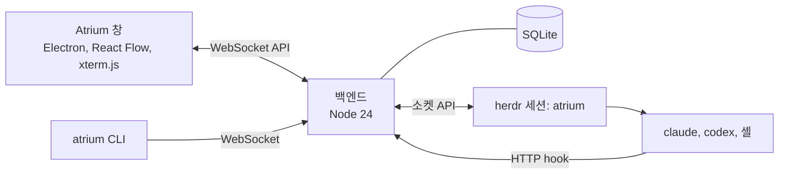

이 저장소는 [Gudals0320/atrium](https://github.com/Gudals0320/atrium)에 macOS 지원, 한국어 UI 개선, Codex 모델 선택과 안정성 수정을 추가한 버전입니다. 원본 프로젝트의 MIT 라이선스와 저작권 표시는 유지합니다.

<p align="center">
  
</p>

<p align="center">
  <b>CLI 코딩 에이전트를 한 판(무한 캔버스)에.</b><br>
  Claude Code, Codex, 셸 세션을 한눈에 보고, 누구 차례인지 알고, 창을 옮기지 않고 말을 겁니다.
</p>

<p align="center">
  
  
  
  
</p>

<p align="center">
  <a href="README.md">English</a> · <b>한국어</b>
</p>


## 왜

에이전트 CLI 다섯 개를 터미널 탭 다섯 개에 띄우면, 그중 하나가 질문을 던지고 20분 동안 기다리기 전까지는 잘 돌아갑니다. Atrium은 모든 세션을 한 판에 올립니다. 폴더마다 영역이 생기고, 세션마다 살아 있는 터미널과 상태가 보이며, 내 답이 필요한 세션은 주황색으로 빛납니다.

Atrium은 에이전트를 대신하지 않고 일하는 방식을 정하지도 않습니다. 판은 세션을 띄우고, 세션끼리 연결해 주고, 그 연결을 보여 줍니다. 일은 에이전트가 하고, 서로에게 일을 맡길 때는 [herdr](https://herdr.dev)를 씁니다.

## 기능

- **모든 세션을 한 판에.** Claude Code, Codex, DeepSeek(로컬 게이트웨이를 거치는 Claude Code), 일반 셸이 나란히 놓입니다. 저장소마다 영역이 있고, 살아 있는 git 워크트리는 브랜치 화살표가 달린 위성 영역으로 보입니다.
- **누구 차례인지.** 세션마다 상태(일하는 중, 준비, 내 차례, 오류)를 herdr 이벤트와 Claude Code hook으로 계산합니다. **내 차례**와 **검토** 목록, OS 알림, 트레이 배지가 볼 곳을 알려 줍니다. `AskUserQuestion` 질문에는 노드 위 카드에서 바로 답합니다.
- **판에서 말 걸기.** 명령 바에 `@이름`(또는 `@all`)을 씁니다. 세션마다 전달 대기열이 있고, 에이전트가 글을 실제로 제출하면 확인됩니다.
- **확대되는 살아 있는 터미널.** 노드마다 진짜 xterm.js 터미널입니다. 멀리 보면 노드가 요약 카드(이름, 상태, 기다리는 질문, 마지막 요청, 마지막 답)로 바뀝니다. 노드를 누르면 그 노드로 날아갑니다.
- **덩어리.** 세션을 tmux처럼 분할 배치로 붙입니다. 세션 수(2~6, 7 이상)마다 배치 틀이 있습니다.
- **에이전트 사이의 연결.** 한 세션에서 다른 세션으로 선을 긋고 `worker`, `reviewer` 같은 역할을 줍니다. 에이전트는 그 역할에게 herdr로 일을 맡기는 법을 알게 되고, 일이 오가는 동안 선이 빛납니다. 에이전트가 하위 세션(`atrium child`)을 띄우면 상한이 있는 나무 모양으로 놓입니다.
- **지난 대화 이어 가기.** 연 폴더의 지난 Claude Code CLI 대화가 대화 노드로 보이고, 이어 갈 수 있습니다. 시험 폴더에 남은 대화는 *missed* 목록에 모았다가 한꺼번에 지웁니다.
- **한눈에 보기.** 누가 누구에게 시키는지 보여 주는 미션 맵, 마지막으로 본 뒤의 변화, 세션을 가로지르는 `Ctrl+F` 찾기.
- **판 위의 메모.** 마크다운 메모와 칸반을 세션 옆에 둡니다. 루프는 같은 지시를 주기마다, 또는 세션이 쉴 때 다시 보냅니다.
- **메모리를 아낌.** 30분(설정 가능) 동안 조용한 저장소는 통째로 잠들고 통째로 깹니다. 노드마다 메모리 사용량이 보입니다.
- **계속 돎.** 세션은 herdr 안에서 돌기 때문에 창을 닫아도 멈추지 않습니다. 창이나 백엔드를 다시 켜면 판이 세션을 다시 붙잡습니다.
- **스크립트로 다루기.** `atrium` CLI와 로컬 WebSocket API로 띄우기, 보내기, 잇기, 붙이기, 끄기 등을 합니다.
- 영어와 한국어 화면.

<table>
  <tr>
    <td width="50%"></td>
    <td width="50%"></td>
  </tr>
  <tr>
    <td align="center"><sub>연결이 있는 덩어리: 리드가 작업자 둘에게 일을 맡깁니다.</sub></td>
    <td align="center"><sub>내 차례: 노드 위에서 바로 답합니다.</sub></td>
  </tr>
</table>

## 필요한 것

Windows 10·11(x64)과 **macOS 포팅 버전**을 제공합니다. macOS는 Apple Silicon에서 실행을 검증했으며, Intel용 설치 경로는 준비되어 있지만 실기기 검증은 하지 않았습니다.

| | |
|---|---|
| [Node.js](https://nodejs.org/) | 24.x |
| [herdr](https://herdr.dev/tui/) | 0.9.5, 프로토콜 22. Mac 설치 명령은 프로젝트 안에 고정 버전을 받습니다. `ATRIUM_HERDR`로 직접 지정할 수 있고, 그 밖에는 PATH와 플랫폼별 설치 위치를 찾습니다. |
| [Claude Code](https://docs.anthropic.com/en/docs/claude-code) | `PATH`에 있는 최근 `claude` CLI. |
| Git | 저장소와 워크트리를 알아내는 데 씁니다. |
| 선택 | Codex 세션에는 Codex CLI. DeepSeek 세션에는 `127.0.0.1:10100`의 Anthropic 호환 게이트웨이(예: opencodex). |

## 시작하기

### macOS

Node.js 24와 Git, 사용할 에이전트 CLI를 먼저 설치합니다. 이 저장소의 폴더에서:

```sh
cd app
npm run setup:mac
npm run mac
```

`setup:mac`은 Apple Silicon·Intel에 맞는 공식 herdr 0.9.5를 SHA-256으로 검증하여 `.tools/`에 저장하고 npm 의존성을 설치합니다. 전역 설치나 셸 설정 변경은 하지 않습니다. 설치 후에는 `npm run mac`만 실행합니다. 개발 프로필은 `npm run mac -- --dev`입니다.

실제 판 데이터는 `~/Library/Application Support/atrium`, 창 프로필은 `~/Library/Application Support/atrium-app-real`에 저장됩니다. herdr는 `~/.config/herdr/sessions/atrium`의 Unix 소켓을 사용하며 `XDG_CONFIG_HOME`을 따릅니다. 창을 닫아도 세션은 남습니다. 완전히 종료하려면 트레이의 종료 메뉴를 이용합니다.

Mac의 Command 복사·붙여넣기·검색, Dock 재열기, 휴지통 이동을 지원합니다. 실제 한글 IME 조합, OS 알림 클릭, 재부팅 복구는 별도 실사용 점검이 필요합니다. 서명·공증된 `.dmg` 배포판은 아직 없습니다.

### Windows

```powershell
git clone https://github.com/Qualop/atrium-macos.git
cd atrium-macos\backend
npm install
cd ..\app
npm install
npm run real
```

`npm run real`은 창을 빌드하고 판을 엽니다. 백엔드가 돌고 있지 않으면 창이 띄우고(포트 47800), 백엔드는 `atrium`이라는 자기 herdr 세션을 띄웁니다. 다른 herdr 세션은 건드리지 않습니다. 판의 데이터는 `%LOCALAPPDATA%\atrium`에 있습니다.

바탕화면 바로가기를 만들려면:

```powershell
powershell -ExecutionPolicy Bypass -File app\scripts\make-shortcut.ps1
```

그다음 판에서 폴더를 열고 왼쪽 레일에서 세션을 띄웁니다.

### 알아 둘 것

- Atrium은 `~/.claude/settings.json`을 고치지 않습니다. 판이 띄우는 Claude Code 세션마다 설정 파일을 따로 만들어 `--settings`로 넘기고, 그 파일의 hook이 상태를 판에 알립니다.
- 연 폴더의 지난 대화를 보여 주고 이어 가기 위해 `%USERPROFILE%\.claude\projects` 아래 Claude Code 대화 파일을 읽습니다.
- 모든 것이 내 컴퓨터에서 돕니다. 창은 `127.0.0.1`의 백엔드와, 백엔드는 herdr와 이야기합니다.
- 신뢰 확인("이 폴더의 파일을 신뢰합니까?")은 대신 수락하지 않고 사용자에게 남겨 둡니다.

## 구조



- **herdr**가 터미널과 프로세스를 쥡니다. 창이나 백엔드가 멈춰도 세션은 계속 돕니다.
- **백엔드**(`backend/`)는 herdr 이벤트와 Claude Code hook으로 세션 상태를 계산하고, 세션마다 전달 대기열을 돌리고, 연결과 이벤트를 남기고, 판을 SQLite(`node:sqlite`)에 저장합니다. 의존성은 `ws` 하나입니다.
- **창**(`app/`)은 React Flow로 판을 그리고, 보이는 터미널에 xterm.js를 붙입니다.

## 개발

```powershell
cd app
npm start            # 개발용 프로필: herdr 세션 atrium-dev, 포트 47811, 데이터 backend\.dev\
cd ..\backend
npm test             # 백엔드 단위 시험
cd ..\app
npm test             # 창 단위 시험
```

개발용 판은 실제 판(`atrium`, 포트 47800)을 건드리지 않습니다. `app/test/e2e/`의 시험 스크립트는 따로 띄운 개발용 판에서 Playwright로 창을 움직입니다. [docs/testing.md](docs/testing.md)를 봅니다.

설계 문서:

- [docs/BRIEF.md](docs/BRIEF.md): 왜, 무엇, 정한 것, 사용성 원칙, 위험
- [docs/ARCH.md](docs/ARCH.md): 프로세스, 상태 모델, 기능, 모듈, API, 화면
- [docs/PLAN.md](docs/PLAN.md): 지금 할 일과 열린 결정
- [docs/decisions.md](docs/decisions.md): 결정이 바뀐 경위

## 상태

Atrium은 초기 프로젝트입니다. Claude Code와 함께 단계별로 만들었고, 화면은 매일 쓰면서 다듬고 있습니다. 거친 곳이 있을 수 있으니 문제를 만나면 이슈로 알려 주세요.

## 고마운 것

- [herdr](https://herdr.dev), [React Flow](https://reactflow.dev), [xterm.js](https://xtermjs.org), [Electron](https://www.electronjs.org).
- 글꼴: Geist, JetBrains Mono, Pretendard, 나눔고딕코딩(SIL Open Font License).
- Claude, Codex, DeepSeek, Grok, Pi의 이름과 로고는 각 소유자의 상표입니다. Atrium은 세션 종류를 표시하는 데만 쓰며, 이들과 제휴하거나 보증받지 않았습니다.

자세한 내용은 [app/THIRD_PARTY_NOTICES.txt](app/THIRD_PARTY_NOTICES.txt)에 있습니다.

## 라이선스

[MIT](LICENSE) © 2026 Gudals0320
