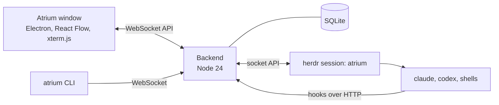

Atrium for macOS, with a Korean interface, automatic Codex model discovery, and session recovery improvements.

<p align="center">
  
</p>

<p align="center">
  <b>One infinite canvas for all your CLI coding agents.</b><br>
  See every Claude Code, Codex and shell session at once, know whose turn it is, and talk to them without switching windows.
</p>

<p align="center">
  
  
  
  
</p>

<p align="center">
  <b>English</b> · <a href="README.ko.md">한국어</a>
</p>


## Why

Running five agent CLIs in five terminal tabs works until one of them asks you a question and waits for twenty minutes. Atrium puts every session on one board. Each folder gets its own area, every session shows its live terminal and its state, and the ones that need you glow orange.

Atrium does not replace your agents or tell them how to work. It starts the sessions, connects them, and shows the connections. The agents still do the work, and they delegate to each other through [herdr](https://herdr.dev).

## Features

- **One board for every session.** Claude Code, Codex, DeepSeek (Claude Code through a local gateway) and plain shells live side by side. Each repository gets an area, and live git worktrees appear as satellite areas with branch arrows.
- **Know whose turn it is.** Every session is *working*, *ready*, *your turn* or *error*, computed from herdr events and Claude Code hooks. The **Your turn** and **Review** queues, OS notifications and a tray badge tell you where to look. Answer an `AskUserQuestion` prompt from a card on the node.
- **Talk from the board.** Type `@name` (or `@all`) in the command bar. Each session has its own delivery queue, and every message is confirmed when the agent actually submits it.
- **Live terminals that zoom.** Every node is a real xterm.js terminal. Zoom out and nodes turn into summary cards: name, state, pending question, last request, last answer. Click any node to fly to it.
- **Docks.** Snap sessions together into tmux-style split layouts, with layout presets for 2 to 7+ sessions.
- **Links between agents.** Draw a link from one session to another and give it a role, such as `worker` or `reviewer`. The agent learns how to hand work to that role through herdr, and the link lights up while work moves along it. Agents can also start child sessions (`atrium child`), which appear as a tree with spawn limits.
- **Pick up old conversations.** Past Claude Code CLI conversations in an open folder show up as chat nodes that you can resume. Leftovers from test folders go to a *missed* list that you can clear in bulk.
- **Overviews.** A mission map of who directs whom, a list of changes since you last looked, and `Ctrl+F` search across sessions.
- **Notes on the canvas.** Markdown memos and kanban boards sit next to the sessions. Loops resend an instruction on a schedule or whenever a session goes idle.
- **Easy on memory.** A repository that has been idle for 30 minutes (configurable) goes to sleep and wakes up as a whole. Each node shows its memory use.
- **Keeps running.** Sessions live in herdr, so closing the window does not stop them. The board picks them back up when the window or the backend restarts.
- **Scriptable.** The `atrium` CLI and a local WebSocket API cover spawn, send, link, dock, kill and more.
- English and Korean UI.

<table>
  <tr>
    <td width="50%"></td>
    <td width="50%"></td>
  </tr>
  <tr>
    <td align="center"><sub>A dock with links: the lead hands work to two workers.</sub></td>
    <td align="center"><sub>Your turn: answer the question right on the node.</sub></td>
  </tr>
</table>

## Requirements

Atrium supports Windows 10/11 (x64) and an experimental macOS port. The port has been exercised on Apple Silicon; Intel installation is provided but has not been tested on hardware.

| | |
|---|---|
| [Node.js](https://nodejs.org/) | 24.x |
| [herdr](https://herdr.dev) | 0.9.5. Atrium looks for `%USERPROFILE%\.herdr\packages\standalone\releases\0.9.5-x86_64-pc-windows-msvc\herdr.exe`. Set `ATRIUM_HERDR` to use another path. |
| [Claude Code](https://docs.anthropic.com/en/docs/claude-code) | A recent `claude` CLI on `PATH`. |
| Git | For repository and worktree detection. |
| Optional | Codex CLI for Codex sessions. An Anthropic-compatible gateway on `127.0.0.1:10100` (for example opencodex) for DeepSeek sessions. |

## Quick start

### macOS

Install Node.js 24, Git and your agent CLI, then run from this checkout:

```sh
cd app
npm run setup:mac
npm run mac
```

Setup downloads the official herdr 0.9.5 binary for your architecture into `.tools/`, verifies its SHA-256 and installs npm dependencies. It does not install anything globally. Subsequent launches only need `npm run mac`; add `-- --dev` for the development profile. `ATRIUM_HERDR` overrides the executable.

Board data lives in `~/Library/Application Support/atrium`. Herdr uses a Unix socket under `~/.config/herdr/sessions/atrium` (or `XDG_CONFIG_HOME`). Closing the window keeps sessions running. Command shortcuts, Dock reopening and macOS Trash are supported. IME composition, notification clicks and reboot recovery still need manual testing. No signed/notarized DMG is included.

### Windows

```powershell
git clone https://github.com/Qualop/atrium-macos.git
cd atrium-macos\backend
npm install
cd ..\app
npm install
npm run real
```

`npm run real` builds the window and opens the board. The window starts the backend if it is not running (port 47800), and the backend starts its own herdr session named `atrium`. Your other herdr sessions are not touched. Board data lives in `%LOCALAPPDATA%\atrium`.

To add a desktop shortcut:

```powershell
powershell -ExecutionPolicy Bypass -File app\scripts\make-shortcut.ps1
```

Then open a folder from the board and start a session from the left rail.

### Good to know

- Atrium never edits your `~/.claude/settings.json`. Each Claude Code session it starts gets its own settings file through `--settings`, which holds the hooks that report state back to the board.
- Atrium reads Claude Code conversation files under `%USERPROFILE%\.claude\projects` for the folders you open, so it can list and resume past conversations.
- Everything runs on your machine. The window talks to the backend on `127.0.0.1`, and the backend talks to herdr.
- Trust prompts ("Do you trust the files in this folder?") are left for you to answer.

## How it works



- **herdr** owns the terminals and processes. Sessions keep running when the window or the backend stops.
- **The backend** (`backend/`) computes session state from herdr events and Claude Code hooks, runs one delivery queue per session, records links and events, and stores the board in SQLite (`node:sqlite`). Its only dependency is `ws`.
- **The window** (`app/`) draws the board with React Flow and attaches xterm.js to the visible terminals.

## Development

```powershell
cd app
npm start            # dev profile: herdr session atrium-dev, port 47811, data in backend\.dev\
cd ..\backend
npm test             # backend unit tests
cd ..\app
npm test             # window unit tests
```

The development board never touches the real board (`atrium`, port 47800). End-to-end scripts in `app/test/e2e/` drive the window with Playwright on a separate dev board. See [docs/testing.md](docs/testing.md).

Design documents are in Korean:

- [docs/BRIEF.md](docs/BRIEF.md): why, what, decisions, usability principles, risks
- [docs/ARCH.md](docs/ARCH.md): processes, state model, features, modules, API, screens
- [docs/PLAN.md](docs/PLAN.md): current work and open decisions
- [docs/decisions.md](docs/decisions.md): how past decisions changed

## Status

Atrium is an early project. It was built in stages with Claude Code, and the interface is still being polished from daily use. Expect rough edges, and please open an issue when you hit one.

## Acknowledgments

- [herdr](https://herdr.dev), [React Flow](https://reactflow.dev), [xterm.js](https://xtermjs.org) and [Electron](https://www.electronjs.org).
- Fonts: Geist, JetBrains Mono, Pretendard and Nanum Gothic Coding, under the SIL Open Font License.
- Claude, Codex, DeepSeek, Grok and Pi names and logos are trademarks of their owners. Atrium uses them only to label session kinds and is not affiliated with or endorsed by them.

See [app/THIRD_PARTY_NOTICES.txt](app/THIRD_PARTY_NOTICES.txt) for details.

## License

[MIT](LICENSE) © 2026 Gudals0320
