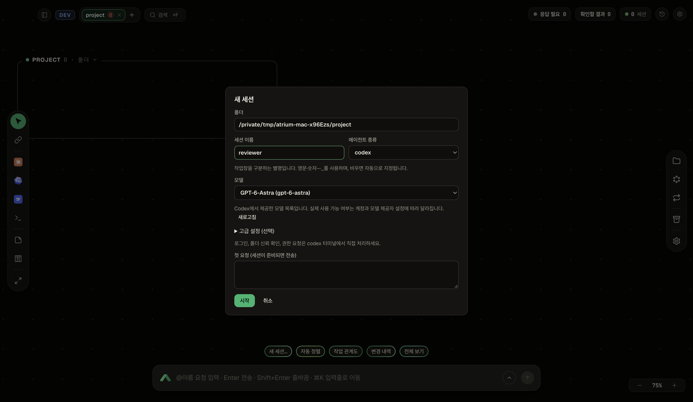

<p align="center">
  
</p>

<p align="center">
  <b>Your AI coding sessions, together on one canvas.</b><br>
  A macOS desktop workspace for Claude Code, Codex, Gemini CLI and terminals.
</p>

<p align="center">
  <b>English</b> · <a href="README.ko.md">한국어</a> · <a href="LICENSE">MIT</a>
</p>

Atrium keeps AI coding sessions, project folders, notes and delegated work on one canvas. Claude Code, Codex, Gemini CLI, Antigravity and your shell run inside herdr terminals; Atrium manages their layout, connections and message delivery.

The **0.4 source integration** brings upstream features through P111 to the macOS branch, including phone access, optional passkeys and push, native bundle updates, and finer layout and sleep controls. Native Codex/Gemini integrations and worker limits remain. Integration, native-runtime and packaging checks are still in progress; this is not a release-completion notice.



*Earlier macOS UI capture from an isolated project. Current model choices come from the installed provider tools and account configuration.*

## Download and build status

Published packages and checksums are listed in the [Qualop/atrium-macos releases](https://github.com/Qualop/atrium-macos/releases). The 0.4 release artifacts, final validation results and direct download links are pending the remaining integration and package checks.

macOS packages target macOS 13 or later and include Node and herdr. Agent CLIs, credentials and sign-in remain separate. Local packages use an ad-hoc signature; this is not Apple notarization.

## Start on macOS

Source builds need **Node.js 22.13+ (22.x), 24.x or 26.x**, **Git**, and the agent CLIs you intend to use.

```sh
git clone https://github.com/Qualop/atrium-macos.git
cd atrium-macos/app
npm run setup:mac
npm run mac
```

`setup:mac` installs dependencies and downloads the architecture-specific herdr 0.9.5 binary with a SHA-256 check into the checkout's `.tools/` directory. It does not install herdr globally or edit your shell configuration. `npm run mac` starts the board again after setup.

The board can open without herdr: stored layout, notes and history remain available, while terminal operations explain the missing engine. Set an executable in Settings or use `ATRIUM_HERDR`. Discovery considers explicit configuration, the bundled executable, PATH and known installation locations. Compatibility is checked by protocol and capabilities; the bundled baseline is herdr 0.9.5 / protocol 22.

## Start a session and save a preset

1. Open a project folder with **+**.
2. Open **New session…**, or Shift-click a launcher in the left rail.
3. Enter a session name such as `reviewer`. It identifies the session, independently of the model.
4. Choose a launcher/provider and model, then start. Answer login, trust and questions in its terminal. Tool approvals follow the board setting below.
5. Send an instruction from the bottom input:

   ```text
   @reviewer Explain this project's structure. Do not change files.
   ```

A **launcher** is a named preset containing the CLI provider, model, supported options, extra arguments and environment variables, or a raw shell command. Settings lets you create, edit, preview, favorite and reorder them. Quoted arguments retain their boundaries. Command presets pass environment variables to the process separately; secret values are not typed into the terminal as an environment prefix.

New boards have four favorites: Claude Code, Codex, Gemini and Shell. Existing boards retain DeepSeek as a fifth favorite. There is **one default Gemini launcher**, using Antigravity (`agy`) with the Gemini logo and its actual provider label. Gemini CLI remains available as a separate provider choice. Preset migration preserves existing defaults and user favorite changes. Calls without a launcher continue to use the legacy session defaults.

Model lists reflect the installed tools: **Codex `model/list`**, **Gemini CLI metadata**, and **Antigravity `agy models`**. Claude aliases and configured gateway catalogs supplement them. A gateway model can run through Claude Code even if its model name resembles another provider's model. A listed model does not guarantee account access. Manual model IDs remain available in session setup.

`Enter` sends; `Shift+Enter` adds a line. `⌘K` focuses the input and `⌘F` searches on macOS. `@all` targets agent sessions across the **whole board**. Enter shell commands in the terminal. Choose **Settings → Language → 한국어** for Korean.

### Gemini and delegated workers

For Google-account work, use **Gemini (Antigravity)** after installing and signing in to `agy`. Gemini CLI remains available for its supported authentication modes. Both providers keep their native sign-in and conversation formats. Automatic tool mode does not answer login, trust or questions for you.

Assign a role between sessions, then ask the working agent to delegate through Atrium. Managed Claude, Codex, Gemini CLI and agy sessions can use `atrium models` and `atrium child`. Child names should describe their task. For example, from a managed session:

```sh
atrium models
atrium child api-review --launcher Codex --prompt "Review the API change and report findings. Do not edit files."
atrium child docs-review --model "haiku" --effort low --prompt "Review the documentation only."
atrium children
```

Natural model names resolve against those catalogs. Unknown or ambiguous names return candidates instead of silently launching a different model. A child inherits its parent's provider and compatible model unless overridden. **Limits remain enabled:** by default, 4 direct children per session, depth 3 and 16 children across the board. Concurrent requests reserve capacity; only descendants can be killed through child commands.

Claude worktree workers require a repository with a commit. In an untrusted repository, Atrium first shows a trust prompt without `--worktree`, holds queued instructions, and restarts in the worktree only after human trust and pane readiness are confirmed. Use `atrium child-wait <name>` while this is pending. A timeout does not grant trust.

Gemini CLI uses a separate managed profile. Antigravity uses the named `atrium-board` hook entry while preserving other hooks; an explicit hooks-disabled preference remains respected. Its completed answers come from the native transcript, with terminal text as a fallback. Automatic history indexing and sleep remain Claude-specific, apart from explicit imported-copy workflows below.

## Bring selected desktop history onto the board

The import dialog lists eligible **Claude and Codex** histories with nothing preselected. Import only the conversations you choose. The source stays outside the board; this is a copy workflow, not attachment to a live desktop terminal.

- **Claude:** creates a separate conversation snapshot and board settings, then registers the copy as sleeping. Source files are not rewritten.
- **Codex:** uses the native app-server's list/read/model and `thread/fork` operations. The board UUID and native copied-thread UUID are separate. Import does not submit a turn or resume, archive or terminate the source. A reported active source is refused; activity in every other client cannot be inferred from a private app-server.
- Opening or messaging an imported Codex copy wakes that copy through `codex resume <copied-thread-id>`. Missing native identity is an error, not a fresh conversation fallback. Import alone does not start work, and waking a project does not launch all untouched imported copies.

A copied conversation may use the original's working folder; importing history does not copy project files or create a worktree. Development imports require explicitly isolated history locations. Existing Claude outside-history indexing and its bound-conversation checks remain separate from desktop import.

## What the 0.4 integration adds

| Area | Source behavior |
|---|---|
| Response needed | `ResponseNotice` explains questions, trust, sign-in or errors. Its action and native OS notification clicks open the actual terminal; desktop approval/answer cards are replaced. |
| Names and delegation | Display labels, including Korean, can change while agent addresses stay stable. Child providers receive compatible permission settings; limits remain 4 direct children, depth 3 and 16 board children. |
| Layout and groups | Mixed-worktree docks stay in their repository, workers form columns, nested folders can group automatically, and whole-board arrangement considers relationships with undo. Sizing preserves the dock tree's proportions. |
| Sleep scopes (P111) | Eligible managed Claude sessions can sleep individually even while their project is busy. Project-scoped wake leaves individually sleeping sessions alone; selecting one wakes that session. Untouched imports remain asleep. |
| Phone and browser | Phone board, mission and terminal views, touch controls, optional passkeys, cookie sessions and per-device push subscriptions. Remote access remains off by default. |
| Native updates | Stable/dev release selection for complete macOS bundles from this fork's repository, with checksum, bundle/signature and compatibility checks before replacement. |
| Preserved integrations | Dynamic provider catalogs, one Gemini/agy default favorite, exact native conversation recovery, Codex copies, private command/env replay, macOS shortcuts and IME, notes, kanban, search and request history. |

**Automatic tool mode** is a board setting, `agentAutoApprove`, whose public default is **false**. Enable it explicitly on a board to apply the provider's automatic tool flags to managed Claude Code, Codex, Gemini CLI and agy launches, reopen and wake. It does not edit global CLI permission settings or answer login, project trust or questions. Remaining prompts lead to the terminal through Response needed and notifications.

## Multiple clients and optional browser access

Electron windows and registered browsers share board state. Each client keeps its viewport, while terminal controllers share frames and track size ownership and connection generations.

**Browser and remote access are off by default.** Enable them from the local **Connected devices** settings. The backend listens on loopback; remote browsers use explicitly configured Tailscale Serve. `atrium remote status` and `atrium remote guide` describe the setup. `atrium remote enable` previews changes; `--yes` authorizes them. Disabling remote access closes device connections, stops pairing and removes push subscriptions. Tailscale Funnel is not part of this flow.

Pair with a one-time code or a host-approved request. Browser sessions use HttpOnly, SameSite=Strict cookies, with Secure on HTTPS; server records keep session hashes. **Passkey verification is optional and off by default** (`remotePasskey`). When enabled, registration and later login use WebAuthn challenges bound to the board's origin. Session expiry and disconnection timeouts apply in passkey mode. The Tailscale login/device policy and host pairing remain separate checks.

The phone interface supports board and mission navigation, terminals and sending instructions. Push notifications require permission and a subscription on each device; notification delivery uses that browser's push service. Connected devices can control the host's terminals, so this is not a read-only share. Folder selection, uploads, reconnect indicators and the installable web view remain available.

## In-app macOS updates

The updater uses [Qualop/atrium-macos](https://github.com/Qualop/atrium-macos), with separate stable and dev channels. It downloads a complete app ZIP and matching SHA-256 checksums, validates the bundle, signature, CPU architecture and runtime compatibility, then uses a helper to replace and relaunch the installed app. A saved previous bundle supports recovery after a failed replacement. It does not run release source, npm installation or a build in the checkout. Package and recovery checks for 0.4 remain open.

## Package for Finder

After setup, from the repository root:

```sh
node app/scripts/package-macos.mjs
```

The packaging path builds `out/Atrium.app` with Electron, the packaging Node runtime, herdr and runtime dependencies. Move the app with Finder. Bundled runtime paths are resolved relative to the installed bundle; CLI discovery runs on the recipient's Mac, without embedding the builder's home directory or PATH. The recipient still installs and authenticates the agent CLIs. Build for the target CPU architecture.

Packaging uses staging, signing and verification before placing the output. Move an existing output aside before rebuilding. Source edits do not update an already installed app.

## Data, permissions and shutdown

| macOS data | Default location |
|---|---|
| Board database, logs and session settings | `~/Library/Application Support/atrium` |
| Window preferences | `~/Library/Application Support/atrium-app-real` |
| Herdr session | `~/.config/herdr/sessions/atrium` |
| Development data | `backend/.dev/data` |

`ATRIUM_DATA_DIR`, `ATRIUM_APP_USERDATA`, `ATRIUM_HERDR_SESSION` and `ATRIUM_PORT` override defaults. Herdr also follows `XDG_CONFIG_HOME`. `ATRIUM_REMOTE_ENABLED=0` explicitly locks remote access off; an explicit environment setting overrides the saved switch.

Preset environment values and private runtime data are stored locally; they are not an encrypted secrets vault. Managed credential files have restricted permissions. Public events omit environment values and redact raw commands. Atrium does not change `~/.claude/settings.json`. Providers can send prompts and code to their configured services or gateways.

Closing the window does not stop herdr's work. The menu-bar icon offers separate app, backend and engine controls. To stop sessions as well, choose the action that stops **herdr and all sessions**. Archive keeps history; supported deletion actions require confirmation and move eligible files to Trash. Source desktop conversations are not deleted by importing a copy.

## Development and validation

```sh
npm --prefix backend test
npm --prefix app test
npm --prefix app run build
```

Use `cd app && npm run mac -- --dev` for a separate development board. The [testing guide](docs/testing.md) describes isolated profiles and macOS integration commands. The 0.4 integration still requires final regression, native-runtime, notification-click, updater recovery and packaged-app checks. Test counts and release links will be filled in after those checks. Use fresh temporary profiles and synthetic histories; existing user conversations, Tailscale configuration and global CLI settings are not test fixtures. Node support remains 22.13+ (22.x), 24.x and 26.x; support does not stand in for a completed version matrix.

See the [architecture](docs/ARCH.md), [current decisions](docs/BRIEF.md) and [plan](docs/PLAN.md).

## License and third-party software

[MIT](LICENSE). Dependency licenses and font notices are listed in [THIRD_PARTY_NOTICES](app/THIRD_PARTY_NOTICES.txt). Bundles retain the applicable Atrium, Electron/Chromium, Node, herdr, npm and font notices. Agent names and logos identify the corresponding tools; they do not imply affiliation or endorsement.
